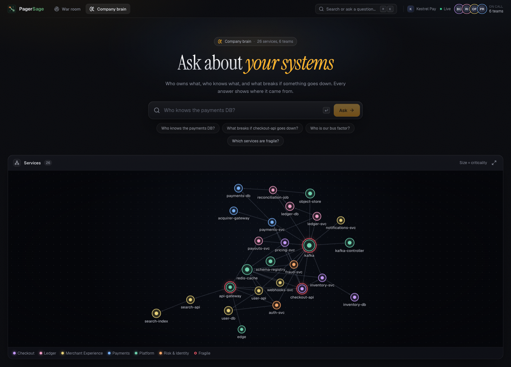

<p align="center">
  <picture>
    <source media="(prefers-color-scheme: dark)" srcset="docs/brand/logo-dark.svg">
    
  </picture>
</p>

# PagerSage

An incident brain. When an alert fires, Claude agents walk a graph of services, deploys,
commits, people and past incidents to find the change that most likely caused it, page the
right owner, cite the last time this happened, and write down what fixed it.

| Part | What |
|---|---|
| `backend/` | FastAPI (Python 3.12, uv), the agents and their tools |
| FalkorDB 6.0.2 | the only datastore: company graph, history, agent memory and handoffs |
| Claude | Haiku 5.5 for Triage and Responder; Sonnet 5.5 for Investigator, Historian, Scribe, Ask |
| fastembed | local `all-MiniLM-L6-v2` vectors (384 dims) for similar-incident search |
| `frontend/` | Next.js 16 + Tailwind: war room, graph canvas, live agent timeline |
| `kestrel-pay/` | the fictional payments company PagerSage watches, and the scenarios that break it |



## Features

- **War room**: live incident feed, the company graph with the root-cause path lit, and
  every agent step (tool call, decision, handoff) streamed as it happens.
- **Root cause**: blast radius, suspect deploys and config changes downstream of the alert,
  and the cheapest path to them through the services that are sick right now.
- **Memory**: "this looks like INC-042": similar past incidents by vector search, reranked by
  what the graph knows about them, plus the runbook that worked most often.
- **Actions**: page the on-call owner on Discord, open a GitHub issue with the path and the
  suspect commit, simulated rollback or config revert.
- **Company brain** (`/brain`): ask "who knows the payments DB?" or "what breaks if
  checkout-api goes down?" and get an answer with the evidence nodes linked.
- **Postmortems**: on resolve, the Scribe writes one and updates the runbook's success count,
  so the next incident ranks better.

## Requirements

- Docker (FalkorDB, and optionally the API)
- Python 3.12 with [uv](https://docs.astral.sh/uv/), Node.js 24
- An Anthropic API key for the agents and Ask. Discord webhook and GitHub token are optional
  ([`docs/setup-accounts.md`](docs/setup-accounts.md)).

## Getting started

```bash
cp .env.example .env               # set ANTHROPIC_API_KEY
make db                            # FalkorDB :6379, FalkorDB Browser :3000
make seed                          # load Kestrel Pay: company files + 90 days of history
make api                           # API :8000
cd frontend && npm ci && cd ..
make web                           # web :3100
make inject                        # in another terminal: break Kestrel Pay
```

Open http://localhost:3100. `make inject` runs the `pool-exhaustion` scenario: a commit
lowers payments-db's connection pool, alerts fire on checkout-api, and the agents take it
from there. `make reset` restores the seeded graph before the next run.

| Command | |
|---|---|
| `make up` / `make down` | FalkorDB + API in Docker instead (data kept in a volume) |
| `make test` | backend + Kestrel Pay tests (needs `make db`; DB tests use a throwaway graph) |
| `make lint` / `make fmt` | ruff + ESLint / auto-format |
| `make inject SCENARIO=<name>` | `pool-exhaustion`, `redis-down` or `inventory-slow` |
| `make eval` | every scenario end to end through the real agents (costs money) |
| `make catalogue` | regenerate [`docs/cypher.md`](docs/cypher.md), the list of every query |
| `make smoke` | call each FalkorDB procedure once, to catch API changes |

## How it works

### Kestrel Pay

- A pretend payments company kept as files: service catalog, org chart and on-call,
  runbooks, policies, and 90 days of history (~400 deploys, ~1,500 commits, 60 config
  changes, 40 incidents with postmortems). [`kestrel-pay/README.md`](kestrel-pay/README.md)
  explains what each file stands in for.
- `make seed` ingests it with `MERGE` on stable ids. At run time Kestrel Pay talks to
  PagerSage only over HTTP: `/ingest/deploy`, `/ingest/config-change` and an
  Alertmanager-compatible `/alerts`. It never touches the database.
- The history has planted patterns the agents should find (pool cuts caused INC-019, 031 and
  042; ledger-svc has one author; checkout-api's deploy is a decoy), and tests keep them true.

### The graph

- Services, teams, people, deploys, commits, config changes, alerts, incidents, runbooks,
  postmortems, plus the agents' own decisions, handoffs and timeline events. The full model is
  in [`docs/build-plan.md`](docs/build-plan.md) section 3.
- `IMPACTS` is a stored reverse of `DEPENDS_ON`: `algo.bfs` has no direction argument, and
  blast radius needs "who calls me".
- Batch jobs after seeding: betweenness (fragility), pageRank (criticality), weakly connected
  components (services no team owns), labelPropagation over co-authored deploys (the teams
  people really work in, next to the org chart).
- Every query is one file in `backend/queries/`, always with `$params`. Read tools run with
  `ro_query`; only the write tools change the graph.

### Agents

```
alert → Triage → Investigator → Historian → Responder        resolve → Scribe
         blast     suspects +     similar      who to page,
         radius    cause path     incidents    policy, actions
```

- A plain Python orchestrator (`agents/orchestrator.py`), no agent framework. Each agent is a
  Claude tool-use loop over a fixed set of graph tools, and finishes by calling `handoff`,
  which writes a `Handoff` node and merges its notes into the incident's shared state.
- **Live weights**: an alert's health (0–1) reprices the edges into that service, so a sick
  service is cheap to walk into and the weighted shortest path (`algo.SPpaths`) runs through
  the sick part of the system. That path is what the canvas highlights.
- **Similar incidents**: the vector index returns cosine distance; candidates are then
  reranked by shared services and causes. Runbooks rank by smoothed success rate
  `(success+1)/(success+fail+2)`, so one lucky run doesn't beat a proven 3/3.
- Every decision is a `Decision` node with `BASED_ON` edges to its evidence and
  `PRECEDENT_FOR` links to earlier decisions, so an incident replays from the graph alone.
- Refusals mark the incident `needs_human`. The stable prompt and tool list come first and
  are cached; text from alerts and commits is treated as data, not instructions.

### Live updates

- Every tool call, decision and handoff is an `Event` node. The web UI follows an incident
  over Server-Sent Events, replaying from `Last-Event-ID` and then tailing new events.

## Ask the graph from Claude Desktop

Add FalkorDB-MCPServer to `claude_desktop_config.json` while `make db` is running:

```json
{
  "mcpServers": {
    "pagersage": {
      "command": "npx",
      "args": ["-y", "@falkordb/mcpserver@1.3.0"],
      "env": {
        "FALKORDB_HOST": "localhost",
        "FALKORDB_PORT": "6379",
        "FALKORDB_DEFAULT_READONLY": "true"
      }
    }
  }
}
```

Then ask: *"In the pagersage graph, which team owns payments-db?"* Queries are read-only, but
the server still offers a `delete_graph` tool, so only point it at a local database.

## Project layout

```
backend/      FastAPI app, agents, tools (pagersage), Cypher queries, tests, evals
frontend/     Next.js: war room, company brain, incident investigation and actions
kestrel-pay/  the fictional company: data, history generator, scenarios, own tests
scripts/      FalkorDB smoke check, Cypher catalogue
docs/         architecture, build plan, contracts, Cypher catalogue, UI design
```

## Notes

- `make inject` makes a real git commit on a new `incident/<scenario>-<time>` branch in this
  repo (the working tree is untouched), the way a CD pipeline would ship it.
- Rollback and config revert are simulated: they write to the graph, not to a real system.
- Not included: a hosted deploy, auth, real monitoring integrations beyond the
  Alertmanager-shaped webhook.

## License

[MIT](LICENSE)
